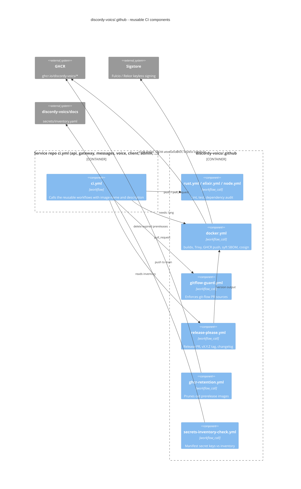

# Architecture

This repository has no runtime service. Its "components" are reusable GitHub
Actions workflows that the Discordy repositories call. Each one is a small
unit with one job. Every input is explicit, and the scripts embedded in the
workflows are covered by `tests/test_workflows.py`.

## C4 component view

## Pipeline order (spec section 13)

lint -> test -> build -> scan (Trivy, cargo-audit, sobelow, pnpm audit) -> SBOM (syft) -> push to GHCR -> cosign signature.

`docker.yml` builds and scans a local single-platform image **before** it
pushes anything, so an image with a CRITICAL vulnerability never reaches the
registry. The multi-platform push that follows reuses the GitHub Actions
BuildKit cache.

## Design decisions

- **No shared script files**: reusable workflows in a private repo cannot
  easily check out their own repo, so every script lives inline in its
  workflow. Values reach the scripts only through `env:`, never through `${{ }}`
  inside `run:`, which prevents script injection. The tests run those inline
  scripts directly.
- **`runs-on` as string-or-JSON**: callers pass `ubuntu-latest` or
  `["self-hosted","discordy"]`. The expression
  `startsWith(inputs.runs-on, '[') && fromJSON(inputs.runs-on) || inputs.runs-on`
  turns either form into a runner selector.
- **Action pinning**: every third-party action is pinned to a commit SHA, with
  the release tag as a comment. Dependabot updates the pins.
